<picture><source media="(prefers-color-scheme: dark)" srcset="assets/hero-dark.svg"></picture>

  

<picture><source media="(prefers-color-scheme: dark)" srcset="assets/about-dark.svg"></picture>

<picture><source media="(prefers-color-scheme: dark)" srcset="assets/stack-dark.svg"></picture>

<a href="https://github.com/AlexJamesHQ/VISION_SYNC"><picture><source media="(prefers-color-scheme: dark)" srcset="assets/project-vision-sync-dark.svg"></picture></a>&nbsp;<a href="https://github.com/AlexJamesHQ/VibeViz"><picture><source media="(prefers-color-scheme: dark)" srcset="assets/project-vibeviz-dark.svg"></picture></a>

<a href="https://github.com/AlexJamesHQ/Portfolio"><picture><source media="(prefers-color-scheme: dark)" srcset="assets/project-portfolio-dark.svg"></picture></a>&nbsp;<a href="https://github.com/AlexJamesHQ/Gemini-Ai"><picture><source media="(prefers-color-scheme: dark)" srcset="assets/project-gemini-ai-dark.svg"></picture></a>

<picture><source media="(prefers-color-scheme: dark)" srcset="assets/stats-dark.svg"></picture>

<picture><source media="(prefers-color-scheme: dark)" srcset="assets/wave-dark.svg"></picture>

<a href="https://alex-james.vercel.app"><picture><source media="(prefers-color-scheme: dark)" srcset="assets/button-site-dark.svg"></picture></a>&nbsp;&nbsp;<a href="https://github.com/AlexJamesHQ?tab=repositories"><picture><source media="(prefers-color-scheme: dark)" srcset="assets/button-repos-dark.svg"></picture></a>

