<picture><source media="(prefers-color-scheme: dark)" srcset="assets/hero-dark.svg"></picture>

<picture><source media="(prefers-color-scheme: dark)" srcset="assets/social-l-dark.svg"></picture><a href="https://www.facebook.com/share/1JAz1nG1c6/"><picture><source media="(prefers-color-scheme: dark)" srcset="assets/social-1-dark.svg"></picture></a><a href="https://www.instagram.com/alex.james.dev?exln=dDg5cG5nZTB6aDBx"><picture><source media="(prefers-color-scheme: dark)" srcset="assets/social-2-dark.svg"></picture></a><a href="https://wa.me/8801977547920"><picture><source media="(prefers-color-scheme: dark)" srcset="assets/social-3-dark.svg"></picture></a><picture><source media="(prefers-color-scheme: dark)" srcset="assets/social-r-dark.svg"></picture>

<picture><source media="(prefers-color-scheme: dark)" srcset="assets/about-dark.svg"></picture>

<picture><source media="(prefers-color-scheme: dark)" srcset="assets/stack-dark.svg"></picture>

<a href="https://github.com/AlexJamesHQ/portfolio"><picture><source media="(prefers-color-scheme: dark)" srcset="assets/project-portfolio-dark.svg"></picture></a>&nbsp;<a href="https://github.com/AlexJamesHQ/AlexJamesHQ"><picture><source media="(prefers-color-scheme: dark)" srcset="assets/project-alexjameshq-dark.svg"></picture></a>

<a href="https://github.com/AlexJamesHQ/ecommerce-platform"><picture><source media="(prefers-color-scheme: dark)" srcset="assets/project-ecommerce-platform-dark.svg"></picture></a>&nbsp;<a href="https://github.com/AlexJamesHQ/react-dashboard-ui"><picture><source media="(prefers-color-scheme: dark)" srcset="assets/project-react-dashboard-ui-dark.svg"></picture></a>

<a href="https://github.com/AlexJamesHQ/fullstack-mern-app"><picture><source media="(prefers-color-scheme: dark)" srcset="assets/project-fullstack-mern-app-dark.svg"></picture></a>

<picture><source media="(prefers-color-scheme: dark)" srcset="assets/stats-dark.svg"></picture>

<picture><source media="(prefers-color-scheme: dark)" srcset="assets/streak-dark.svg"></picture>

<picture><source media="(prefers-color-scheme: dark)" srcset="assets/wave-dark.svg"></picture>

<a href="https://alex-james.vercel.app"><picture><source media="(prefers-color-scheme: dark)" srcset="assets/button-1-dark.svg"></picture></a>&nbsp;&nbsp;<a href="https://github.com/AlexJamesHQ?tab=repositories"><picture><source media="(prefers-color-scheme: dark)" srcset="assets/button-2-dark.svg"></picture></a>

<a href="https://github.com/AlexJamesHQ"><picture><source media="(prefers-color-scheme: dark)" srcset="assets/credit-dark.svg"></picture></a>

